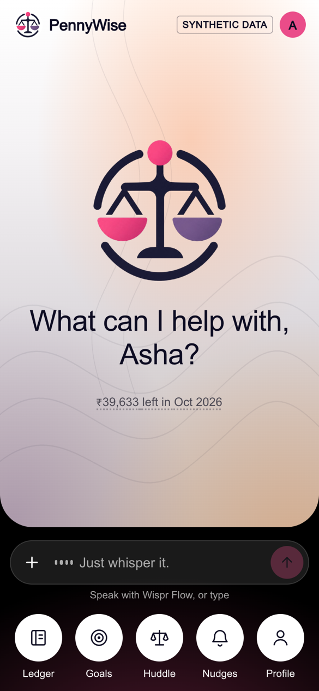
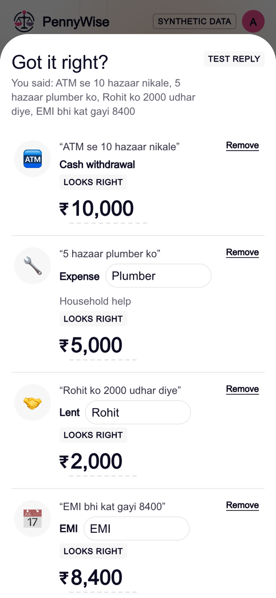
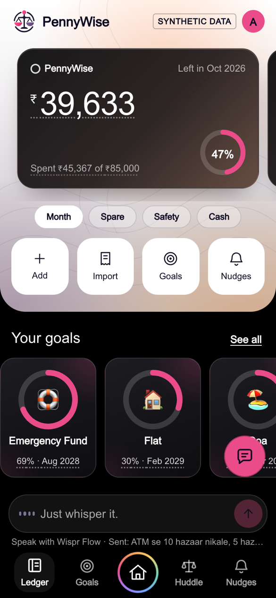
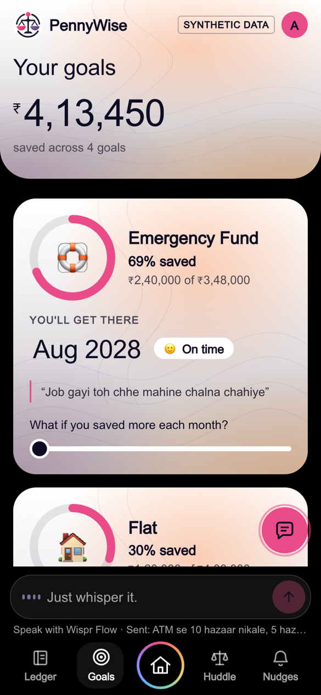
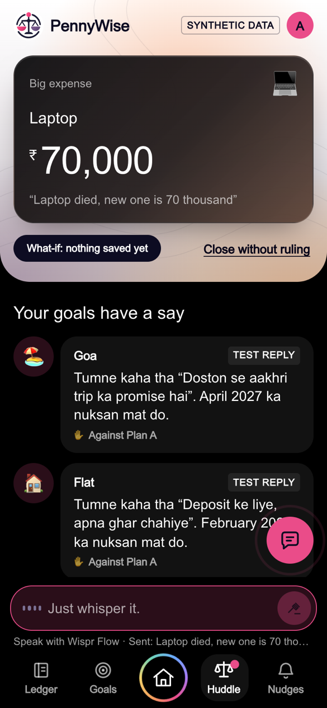
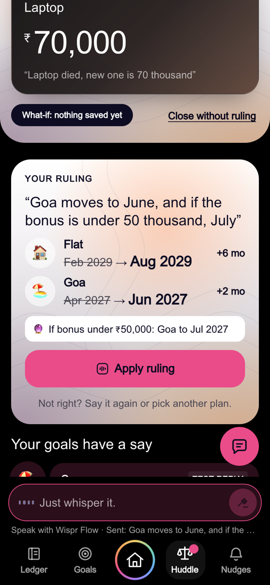
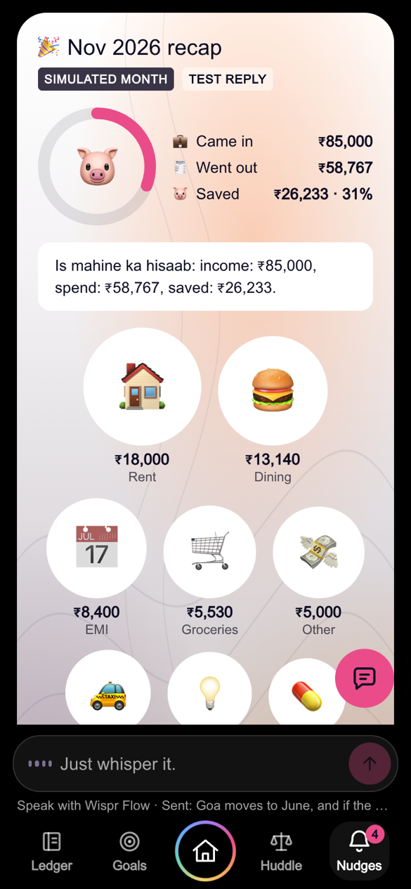
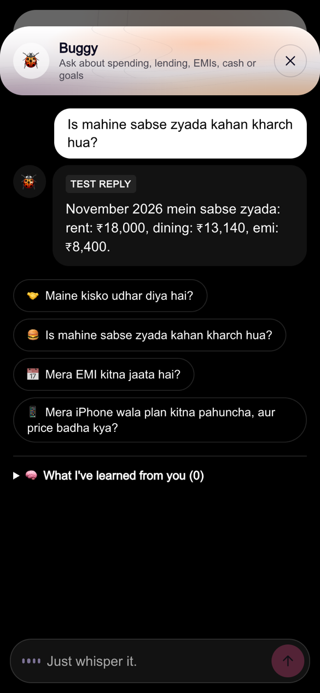
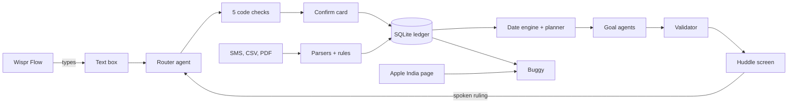

<p align="center">
  
</p>

<h1 align="center">PennyWise</h1>

<p align="center">
  <b>A money coach you talk to. When a big expense threatens your savings goals, the goals argue it out and you make the call.</b>
</p>

<p align="center">
  Built in one day for the <a href="https://theproductspace.in/ai-hackathon-details">Agentic AI Hackathon</a> by Product Space and <a href="https://wisprflow.ai">Wispr Flow</a>, problem 04: personal finance coach with a living money model.
</p>

<table>
  <tr>
    <td></td>
    <td></td>
    <td></td>
    <td></td>
  </tr>
  <tr>
    <td align="center"><b>Home</b><br>One question, one box</td>
    <td align="center"><b>Confirm</b><br>One ramble, four entries</td>
    <td align="center"><b>Ledger</b><br>Every figure explains itself</td>
    <td align="center"><b>Goals</b><br>Rings and live what-ifs</td>
  </tr>
  <tr>
    <td></td>
    <td></td>
    <td></td>
    <td></td>
  </tr>
  <tr>
    <td align="center"><b>Huddle</b><br>Your goals have a say</td>
    <td align="center"><b>Ruling</b><br>You decide, out loud</td>
    <td align="center"><b>Recap</b><br>A month at a glance</td>
    <td align="center"><b>Buggy</b><br>Ask about your money</td>
  </tr>
</table>

<sub>All data on these screens is synthetic. They were captured without an API key, so AI replies carry a "Test reply" badge.</sub>

## Contents

- [What it does](#what-it-does)
- [Quick start](#quick-start)
- [Turn on real AI](#turn-on-real-ai)
- [Speak with Wispr Flow](#speak-with-wispr-flow)
- [Try these lines](#try-these-lines)
- [Commands](#commands)
- [How it works](#how-it-works)
- [What's real and what isn't](#whats-real-and-what-isnt)
- [Project structure](#project-structure)
- [Troubleshooting](#troubleshooting)
- [Limits](#limits)

## What it does

| Section | What you get |
|---|---|
| **Home** | The app opens on one question and one box. Say what happened or ask something. Questions are answered right there, and bubbles lead to every other section. |
| **Ledger** | Spending, income, cash, money lent or borrowed, and EMIs, dictated or imported. A cash withdrawal is a transfer, so ₹10,000 withdrawn and then spent counts once. Hold or hover on a figure to see why it's that value. Any row can be undone. |
| **Goals** | Savings goals as progress rings, with the month you'll reach each one. Drag a slider to see what saving more would change. |
| **Huddle** | A heavy expense calls in the goals it affects. Code finds up to 3 plans, each goal argues its case in its own AI call, and you rule by voice. Rulings can carry conditions and are remembered as precedent. |
| **Buggy** | A chat assistant on every screen. Ask about spending, lending, borrowing, EMIs, cash or goals. It also checks an iPhone goal against Apple India's current list price. |
| **Nudges** | Paste SMS or upload CSV and PDF statements. Corrections become visible rules. "Import next month" shows recurring-payment nudges, spending drift and a monthly recap. |

The app has no speech code. [Wispr Flow](https://wisprflow.ai) types into a plain text box, and the app turns natural speech, in English or Hinglish, into structured entries. Nothing you dictate is saved until you confirm it.

These screens are the mobile app, previewed in a browser at `/phone`. Native Android and iOS builds don't exist yet.

## Quick start

You need **Node 26 or newer**, because the database uses the built-in `node:sqlite`. No API key is needed for the first run.

```bash
# 1. Get the code
git clone https://github.com/yashm-0804/PennyWise.git
cd PennyWise/code/pennywise

# 2. Install
npm install

# 3. Create your settings file
cp .env.example .env.local

# 4. Fill the database with synthetic demo data
npm run seed

# 5. Start the app
npm run dev
```

Open **http://localhost:3000/phone**, enter any name and you're in. Sign-in is a prototype: the name stays on your device, and there's no password or server account.

This first run uses canned AI replies, marked with a "Test reply" badge. They work best with the [example lines](#try-these-lines) below.

To start over at any time, tap **Reset demo** at the bottom of Ledger or Profile.

## Turn on real AI

1. Get a free key from [Google AI Studio](https://aistudio.google.com/apikey).
2. Edit `.env.local`:

   ```bash
   GEMINI_API_KEY=your-key-here
   LLM_MODE=real
   ```

3. Restart `npm run dev`. The "Test reply" badges disappear.

Keep your key out of git. `.env.local` is already ignored.

Google's free tier has low daily limits, and a full run through the demo used about 10 calls. It may also use your prompts to improve Google's products, so **don't enter real financial data with a free-tier key**.

### Settings

| Variable | Default in `.env.example` | What it does |
|---|---|---|
| `GEMINI_API_KEY` | empty | Your Gemini key. Without it, the app uses test replies. |
| `GEMINI_API_KEY_2` | empty | Optional second key, used when the first hits its daily limit. |
| `LLM_MODE` | `fake` | `real` calls Gemini. `fake` uses test replies. |
| `LLM_CACHE` | `0` | `1` reuses identical replies across restarts, which saves quota on retakes. Reused replies are labelled in the app. |
| `MODEL_MAIN` | `gemini-2.5-flash` | The main model. The app falls back to `gemini-2.5-flash-lite`. |
| `DB_PATH` | `./data/app.db` | Where the SQLite database lives. |

## Speak with Wispr Flow

Typing works everywhere, but the app is designed for speech.

1. Install [Wispr Flow](https://wisprflow.ai) on your computer.
2. Open http://localhost:3000/phone and click the box that says "Just whisper it."
3. Speak with Flow. Your words land in the box.
4. Press Send, or Cmd/Ctrl + Enter.

## Try these lines

Start from a fresh **Reset demo** so the numbers match.

| Say this | What happens |
|---|---|
| `Laptop died, new one is 70 thousand, need it this month` | After you confirm, the Huddle opens: three plans, and your goals argue over them. |
| `Goa moves to June, and if the bonus is under 50 thousand, July` | In the Huddle, this becomes a ruling: Goa moves to Jun 2027, Flat to Aug 2029, with a condition on the bonus. |
| `ATM se 10 hazaar nikale, 5 hazaar plumber ko, Rohit ko 2000 udhar diye, EMI bhi kat gayi 8400` | One ramble becomes four entries. The withdrawal counts once, and Rohit now owes you ₹2,000. |
| `Mera iPhone wala plan kitna pahuncha, kitna percent bacha hai, aur price badha kya` | Buggy compares your savings with the price you planned on and with today's Apple India list price, linking its source. |
| `Rahul ko jo jaata hai woh rent hai` | Creates a visible rule. "Import next month" under Nudges then applies it unasked. |
| `kaunsa mutual fund lun` | It refuses to name a security and offers a modelled scenario instead. |

To test imports, tap **+** on Home or go to Nudges, then use the files in [`seed/samples/`](code/pennywise/seed/samples). The password for `statement-locked.pdf` is `demo1234`. The SMS sample includes OTPs and promotions, which are skipped on purpose and counted as "couldn't be read".

## Commands

Run these from `code/pennywise`.

| Command | What it does |
|---|---|
| `npm run dev` | Starts the app in development mode |
| `npm run build` then `npm start` | Builds and runs the production version |
| `npm test` | Runs the Vitest suite: ledger, engine, agents, parsers and guardrails. Screens aren't covered |
| `npm run lint` | Runs ESLint |
| `npm run seed` | **Erases** the database at `DB_PATH` and reloads the demo data |

The `scripts/` folder has developer checks. `e2e-hero.mjs` drives the demo path through the API, so point it at a throwaway database. The others make real Gemini calls, and each file's first lines say how to run it.

```bash
DB_PATH=./data/test.db npx next dev -p 3100
node scripts/e2e-hero.mjs http://localhost:3100
```

## How it works



The main design rule: **the AI never produces a number.**

- **Ledger:** amounts are integer paise, and every event's postings balance to zero. Spending is only what posts to expense accounts, which is why a withdrawal can't count twice.
- **Plans and dates:** a deterministic engine works these out from a closed list of actions. Goal agents write the argument, using placeholders that code fills in.
- **Before anything is saved:** five code checks run: the amount appears in your words, a confirm card quotes your words, unusual amounts are flagged, balances are checked, and everything can be undone.
- **Buggy:** it answers from a fact sheet built in code. A reply containing a figure that isn't on the sheet is rejected, retried once, and then replaced with a no-AI answer.
- **Guardrails:** a validator and deny-list stop model text from naming securities, on every path that shows AI text.

**Stack:** Next.js 16, React 19, TypeScript, Tailwind CSS 4, `node:sqlite`, Gemini through `@google/genai`, zod, pdfjs-dist and Vitest.

## What's real and what isn't

| Part | Status |
|---|---|
| Numbers, plans, dates, rules, nudges | **Real**, calculated in code |
| Goal voices, entry parsing, ruling parsing, recap wording, Buggy's answers | **Real Gemini calls** in real mode. A labelled fallback appears if a call fails |
| Apple India price | **Real fetch** of the list price, with its source and time. Labelled "cached" if a later fetch fails |
| Bank data | **Synthetic.** No real person, account or transaction |
| Next month | **Simulated** from `seed/next-month.json`, and labelled on screen |
| SMS and email | **Pasted or uploaded**, not fetched live |
| Sign-in | **Prototype.** A name kept on the device |
| What-ifs | **Simulations.** A ruling on a what-if moves no money |

## Project structure

```text
code/pennywise/
├── src/
│   ├── agents/       Router, goal voices, ruling parser, validator
│   ├── app/          Pages (/ and /phone) and API routes
│   ├── components/   Screens and UI
│   ├── contract/     Zod schemas and test fixtures
│   ├── engine/       Date engine and planner
│   ├── ingest/       SMS, CSV and PDF parsers, categorisation, rules
│   ├── insights/     Buggy, recurring payments, drift, recaps, price check
│   ├── ledger/       Double-entry ledger and app state
│   ├── lib/          Gemini client and database
│   └── server/       Request handling behind the API routes
├── seed/             Synthetic demo data and sample import files
└── scripts/          Developer checks
docs/
├── brand/            Original logo
└── screenshots/      Images in this README
```

Two internal names differ from what's on screen:

| On screen | In the code |
|---|---|
| Huddle | `panchayat` |
| Nudges | `notices` |

## Troubleshooting

| Problem | Fix |
|---|---|
| Errors about `node:sqlite` | Check `node -v`. This project was built and tested on Node 26.8. |
| Replies still say "Test reply" | Set `LLM_MODE=real` and `GEMINI_API_KEY` in `.env.local`, then restart the server. |
| Replies fall back, or the log shows `429` | You've hit Gemini's free limit. Add `GEMINI_API_KEY_2`, set `LLM_CACHE=1`, or wait for the limit to reset. Calls are logged in `data/llm-calls.log`, which never contains your key. |
| Port 3000 is busy | Run `npm run dev -- -p 3001` and open that port instead. |
| The page looks out of date after pulling changes | Stop the server, run `rm -rf .next`, and start it again. |
| Numbers don't match the examples | Tap **Reset demo**, or stop the server and run `npm run seed`. |

## Limits

- It's a local, single-user prototype. The API has no login, so **don't deploy it publicly as it is**.
- Parsers cover 5 SMS templates, 1 CSV layout and 1 PDF layout, all written from synthetic samples. Real bank formats will vary.
- A plausible wrong amount can only be caught by the person reading the confirm card.
- The guardrail's lists are finite, so it can miss an unusual fund name.
- Questions asked to Buggy aren't kept after you reload the page.
- It educates and models scenarios. **It isn't financial, tax or investment advice, and it isn't a Chartered Accountant.**

## Credits

Built by Yash Mehta by dictating prompts with [Wispr Flow](https://wisprflow.ai) into [Claude Code](https://claude.com/claude-code). The visual direction draws on a Payoneer mobile concept seen on Dribbble. PennyWise isn't affiliated with Payoneer.

No open-source license has been chosen yet, so all rights are reserved.
