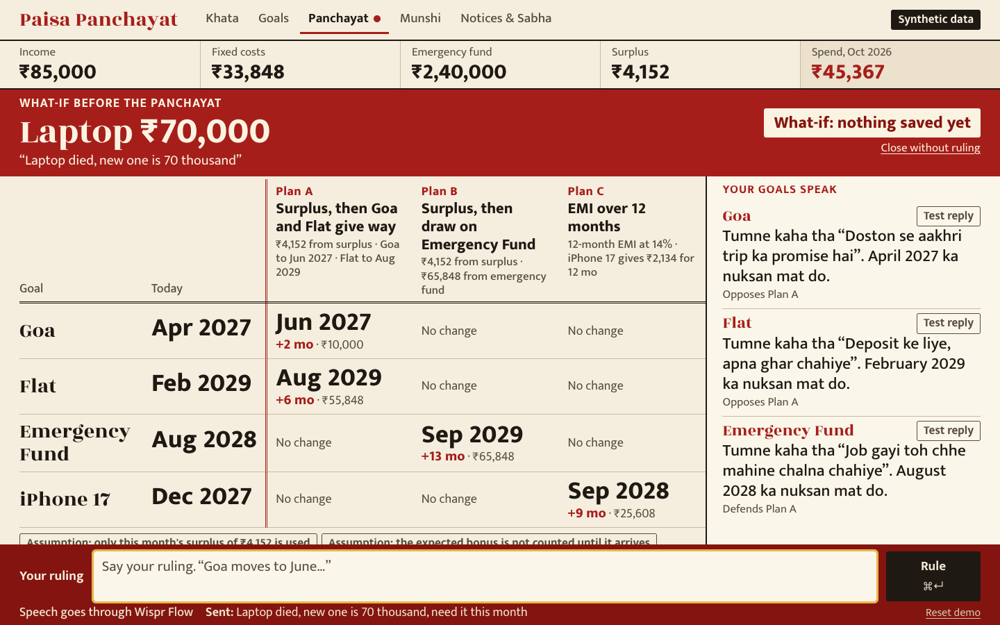
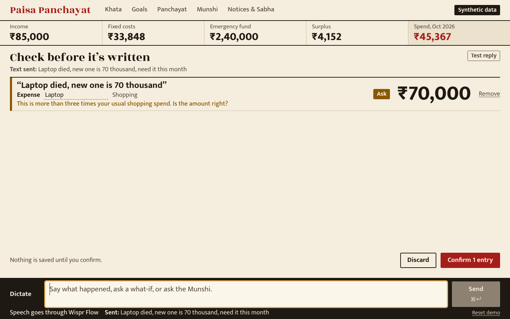
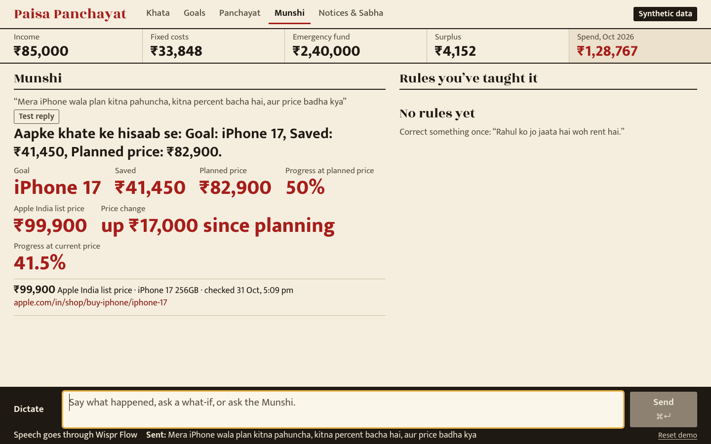
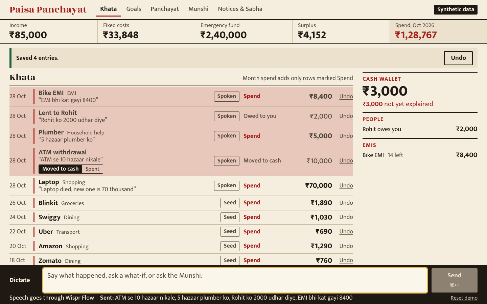
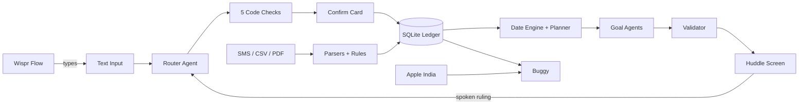

# PennyWise (Paisa Panchayat)

**An AI-powered personal finance coach where your goals argue over your money — and you make the final call by voice.**

Built for the [Agentic AI Hackathon](https://theproductspace.in/ai-hackathon-details) by Product Space × [Wispr Flow](https://wisprflow.ai) (Problem 04: Personal finance coach with a living money model).



---

## What it does

PennyWise is a talk-first money ledger. You dictate expenses in natural English or Hinglish, and the app turns messy speech into structured financial entries. When a big expense threatens your savings goals, those goals literally argue over how to absorb it — and you settle the debate with a spoken ruling.

### Core features

| Feature | Description |
|---|---|
| **Ledger** | Spending, income, cash, lending/borrowing, and EMIs — dictated or imported. Cash withdrawals are tracked as transfers so nothing is double-counted. Every entry requires confirmation before saving; any row can be undone |
| **Home** | Opens with a single question box. Say what happened or ask anything; bubbles lead to every section |
| **Huddle** (Panchayat) | A heavy expense convenes the goals it affects. Code finds up to 3 plans, each goal argues its case via Gemini, and your spoken ruling changes the dates. Rulings can carry conditions and are remembered as precedent |
| **Buggy** (Munshi) | A chat assistant on every screen. Ask about spending, lending, goals, or prices — Gemini answers from your data. Rejects any reply using numbers not in your file. Fetches live Apple India prices and refuses to name securities |
| **Imports & Nudges** | Paste SMS, upload CSV or PDF. Corrections become visible rules. "Import next month" shows recurring-payment nudges, drift alerts, and a monthly review |
| **Guardrails** | Educates and models scenarios — never recommends specific securities. Closed action list, deny-list, and attack-prompt validation |

### How voice works

The app has no speech code. [Wispr Flow](https://wisprflow.ai) types into a plain text box, and the agent turns natural speech — in English or Hinglish — into structured entries. Typing works too.

---

## Screenshots

<table>
<tr>
<td></td>
<td></td>
</tr>
<tr>
<td align="center"><em>Confirm a dictated entry</em></td>
<td align="center"><em>Goals argue over a ₹70K laptop</em></td>
</tr>
<tr>
<td></td>
<td></td>
</tr>
<tr>
<td align="center"><em>Buggy: live iPhone price check</em></td>
<td align="center"><em>Ledger overview</em></td>
</tr>
</table>

---

## Tech stack

| Layer | Choice |
|---|---|
| App | Next.js 16, React 19, TypeScript |
| Styling | Tailwind CSS 4 |
| Database | `node:sqlite` (built into Node 26+) |
| AI | Gemini API via `@google/genai` with Zod schema validation |
| PDF parsing | pdfjs-dist |
| Tests | Vitest |

---

## Getting started

### Prerequisites

- **Node.js 26+** (required for built-in `node:sqlite`)
- A [Gemini API key](https://aistudio.google.com/apikey) (free tier works)

### Setup

```bash
cd code/paisa-panchayat
npm install
cp .env.example .env.local
# Add your GEMINI_API_KEY to .env.local
npm run seed
npm run dev
```

Open [http://localhost:3000/phone](http://localhost:3000/phone) to view the mobile app preview.

> **Fake AI mode:** Without an API key, the app runs in fake mode — replies show a "Test reply" badge. To use real AI, add your key to `.env.local` and set `LLM_MODE=real`.

### Try these

1. `Laptop died, new one is 70 thousand, need it this month` → confirm → rule: `Goa moves to June, and if the bonus is under 50 thousand, July`
2. `ATM se 10 hazaar nikale, 5 hazaar plumber ko, Rohit ko 2000 udhar diye, EMI bhi kat gayi 8400`
3. `Mera iPhone wala plan kitna pahuncha, kitna percent bacha hai, aur price badha kya`
4. `Rahul ko jo jaata hai woh rent hai` → then "Import next month" under Nudges
5. `kaunsa mutual fund lun` (guardrail: refuses to name securities)

For import testing, use the sample files in `code/paisa-panchayat/seed/samples/` (the locked PDF password is `demo1234`).

### Run tests

```bash
cd code/paisa-panchayat
npm test
```

---

## What's real and what isn't

| Part | Status |
|---|---|
| Numbers, plans, dates, rules, alerts | **Real** — calculated in code. The AI never produces a number |
| Goal voices, entry parsing, ruling parsing, review wording | **Real Gemini calls** in real mode |
| Apple India price | **Real fetch** of the list price, with source and timestamp |
| Bank data | **Synthetic.** No real person, account, or transaction |
| Next month | **Simulated** from seed data, labelled on screen |
| SMS and email | Pasted or uploaded, not fetched live |
| Sign-in | **Prototype.** A name on the device — no password or server account |

---

## Project structure

```
├── code/paisa-panchayat/     # The Next.js app
│   ├── src/
│   │   ├── agents/           # Gemini-powered agents (router, goal voices, ruling, safety)
│   │   ├── app/              # Next.js pages and API routes
│   │   ├── components/       # React UI components
│   │   ├── contract/         # Zod schemas, fixtures, module interfaces
│   │   ├── engine/           # Date engine, planner, ruling logic
│   │   ├── ingest/           # SMS, CSV, PDF parsers and categorization
│   │   ├── insights/         # Munshi chat, recurring detection, drift, reviews
│   │   ├── ledger/           # Double-entry ledger and state management
│   │   └── lib/              # LLM client, database singleton
│   ├── seed/                 # Seed data and sample import files
│   └── scripts/              # Utility scripts
├── docs/                     # Planning docs, test reports, and screenshots
│   ├── PLAN.md               # Build plan with architecture and scope
│   ├── BUILD_CHECKLIST.md    # Feature checklist
│   ├── TEST_REPORT.md        # Test results
│   ├── test-runs/            # Screenshots from test runs
│   └── submission/           # Hackathon submission materials
└── research/                 # Problem statements, market analysis, ideation notes
```

---

## Architecture



- **All numbers are computed in code** — the AI never invents a figure
- **5 checks before write:** amount appears in text, quoted confirm card, outlier detection, balance sanity, undo
- **Goal agents** run as separate parallel Gemini calls, each with its own fact sheet
- **Validator** rejects digits in model prose, financial product names, and banned social terms

---

## Hackathon context

- **Event:** Agentic AI Hackathon by Product Space × Wispr Flow (31 Oct 2026)
- **Track:** Problem 04 — Personal finance coach with a living money model
- **Builder:** Yash Mehta
- **Built with:** Claude Code + Wispr Flow (30,508 words dictated, 434 AI prompts)
- **Time:** One-day hackathon

---

## Limits

- Parsers cover 5 SMS templates, 1 CSV layout, and 1 PDF layout from synthetic samples. Real bank formats will vary.
- A plausible wrong amount can only be caught by the person reading the confirm card.
- The guardrail's deny-lists are finite — unusual fund names may slip through.
- It educates and models scenarios. **It is not financial, tax, or investment advice.**
- Local, single-user prototype with no real accounts.

---

## License

Hackathon project — not currently licensed for redistribution.
