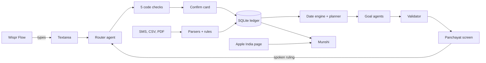

# Paisa Panchayat: build plan

2026-10-31 · Idea: I-9 Paisa Panchayat, full scope · Deadline 2026-10-31 23:59 IST · Feature freeze 17:59 IST · Ship buffer starts 19:59 IST

## Context

Product Space × Wispr Flow one-day hackathon, problem 04 (personal finance coach with a living money model). Solo builder; the only submission is a video. The user chose Paisa Panchayat over a less distinctive coach: a talk-first money ledger where goals argue over heavy expenses and the user rules. They chose full scope over the recommended thin build, kept the 17:59 freeze, and accepted that anything unbuilt then is cut. So required features come first, and the extras they asked for get whatever time remains.

**Decided by the user:** storyline below; Gemini free key; freeze 17:59 then cut; git repo at `code/paisa-panchayat/` with local commits allowed (no pushes).
**Standing decisions:** no speech code (Wispr Flow types into a plain textarea); no "CA" title; synthetic data only; no live SMS or email fetching.

## Demo storyline (about 2:30; figures illustrative until a golden test pins them)

| Beat | On screen | Presenter line | Feature |
|---|---|---|---|
| 1 · 0:00 | Flow indicator visible; "Laptop died, new one is 70 thousand, need it this month." Notice convenes the panchayat | "I just tell it what happened." | Dictation, confirm card |
| ★ 2 · 0:15 | Profile strip visible. 3 code-found plans in a table, labelled "What-if: nothing saved yet"; up to 3 affected goals speak, quoting my reasons; "Goa moves to June, and if the bonus is under 50 thousand, July." Diff, then dates animate | "My goals fight over my money. I make the call." | Planner, goal agents, ruling parser |
| 3 · 0:45 | "ATM se 10 hazaar nikale, 5 hazaar plumber ko, Rohit ko 2000 udhar diye, EMI bhi kat gayi 8400." Rows with quoted phrases; spend counts the cash once; Rohit owes ₹2,000. A self-corrected take shows Flow's text beside the result, crediting Flow | "Your bank can't see cash or who owes whom." | Ledger, checks |
| 4 · 1:05 | Ask Munshi about the iPhone goal: saved 50% of ₹82,900 is 41.5% of ₹99,900, with Apple link and checked-at time | "Progress against today's price, not the price I planned on." | Munshi, price reader |
| 5 · 1:20 | Paste SMS, upload CSV and PDF; "Rahul ko jo jaata hai woh rent hai" makes a visible rule; "Import next month (simulated)" applies it unasked, fires a subscription alert and a nudge, and the ₹42,000 bonus triggers the ruling's condition: a notice moves Goa to July | "Correct it once, and it's learned. Rule once, and it remembers." | Ingestion, rules, recurring, nudges, conditions |
| 6 · 1:50 | Jump cut through an app restart: everything is still there. Monthly sabha; mid-ramble "which fund should I buy?" gets a refusal and a modelled scenario; earlier ruling cited as precedent | "It models scenarios and names no securities." | Persistence, review, guardrails, precedent |
| 7 · 2:05 | 25 seconds of build-by-voice footage, including a bug fixed by voice; labels: synthetic data, simulated month | "Built by voice, with Wispr Flow." | Build footage |

Check the submission form for limits first, because a limit may remove a cut. Otherwise also cut a 90-second version (beats 1, 2, restart, 7). A longer version adds a second, different ruling, which shows it isn't scripted. **A golden test asserts every number in these beats**, and the script uses whatever the test pins.

## Scope

| ID | Item | MoSCoW | Beat |
|---|---|---|---|
| M1 | Balanced-posting ledger: cash wallet, withdrawals as transfers with a user override, lent and borrowed per person, card bills, EMI as a fixed monthly obligation, undo, 11 fixtures | MUST | 3 |
| M2 | Dictation to structured entries in Hinglish (Devanagari and Latin), with quoted phrases, 5 checks, confirm before write | MUST | 1, 3 |
| M3 | Persistent profile with a visible strip and `expected_bonus`, goals with dates and earmarks, deterministic date engine, labelled what-if, synthetic seed data, and the golden beat test | MUST | 2 |
| M4 | Panchayat: heavy-expense trigger, 3 code-found plans, separate goal agents, spoken ruling with conditions that fire on next-month import, diff, precedent | MUST | 2, 5, 6 |
| M5 | SMS paste, CSV, one synthetic PDF layout, categorization, spoken corrections as visible rules | MUST | 5 |
| M6 | "Import next month": recurring detection, price-change and possibly-unused alerts, drift nudges, monthly review | MUST | 5, 6 |
| M7 | Guardrails: closed action list, placeholder numbers, deny-list, 10 attack prompts | MUST | 6 |
| M8 | Munshi: goal progress, person balance, month spend, and the Apple India list price | MUST | 4 |
| M9 | Submission: build footage, video, LinkedIn posts | MUST | 7 |
| S1–S7 | In order: free-form Munshi with function calling · web-search price for other goals · EMI interest split · spoken-vs-import matching · second debate round · monthly-budget agents · split bills, refunds, write-offs | SHOULD | Extras; **realistically most get cut**, because MUSTs finish about 17:45. Any builder running ahead picks up the next one |

**WON'T:** speech code, Wispr API, native app, live SMS, Gmail or Account Aggregator, real personal data, auth or multi-user, tax features, naming securities, deployment (unless Demo Day requires it).

## Architecture

Dictated text goes to the router, which returns typed items. Code checks them, and nothing is written before the confirm card. A heavy expense or what-if makes the planner compute 3 feasible plans. Each affected goal gets its own Gemini call and its own fact sheet, and returns a stance plus a line with placeholders that code fills in. The table stays the authority. Parsed rulings show as a diff, apply on confirm and are stored as precedent.

| Component | Real or mocked | Label |
|---|---|---|
| All numbers, plans, dates, rules, alerts | Real, in code | None needed |
| Goal agents, router, Munshi prose | Real Gemini calls. Template lines on failure | "Template line" badge if shown |
| Apple price | Real fetch, last value cached | Source URL, checked-at, "list price"; "cached" if stale |
| Bank data | Synthetic | "Synthetic data" badge, README, video |
| Next month | Simulated | "Simulated month" on screen |

## Stack (versions checked today; pin at install)

| Layer | Choice | Why |
|---|---|---|
| App | Next.js 16.4.3, React 19.3.1, TypeScript 5 or 6 (not 7), `@types/node` ^24 | One process for UI and API. The default template's `@types/node` ^20 lacks sqlite types and conflicts with vitest 5 |
| Styling | Tailwind 4.3.3 | Fast, large type for video |
| Database | `node:sqlite` in Node 26.8.2, `globalThis` singleton | Works here, no native build; spiked under Next before fan-out |
| LLM | `@google/genai` 2.32.0, Interactions API, zod 4.6.7 validation | User's Gemini key; schema keywords aren't all enforced by the API |
| PDF | pdfjs-dist 6.4.299, legacy build, externalized in Next config | Text extraction, password support; spiked before fan-out |
| Tests | vitest 5.0.5 | Ledger and validator fixtures |
| Recording and edit | OBS and iMovie (installed), ffmpeg (install by 18:00) | Footage and takes; burn subtitles from a script-derived SRT, since no speech-to-text tool is installed |

## Data model

Amounts are integer paise. **Spending is only the sum of postings to expense accounts.**
`accounts` (bank, cash, card, person receivable/payable, emi, expense:*, income:*, opening) · `events` (kind, date, source, source_quote, reversal_of) · `postings` (event, account, amount; each event sums to zero) · `rules` (pattern, category, amount range, reason_quote) · `goals` (type, target, date, reason_quote, contribution, variant, price_url) · `earmarks` (labels, not postings) · `profile` · `recurring` · `notices` · `panchayats` (trigger, plans, lines, ruling, ops; rulings double as precedent) · `conditions` (from rulings, checked on next-month import) · `price_checks` · `utterances` · `sim_clock`.

## API surface

`POST /api/dictate` · `POST /api/confirm` · `POST /api/undo` · `POST /api/import` · `POST /api/next-month` · `POST /api/panchayat` · `POST /api/ruling` · `POST /api/munshi` · `GET /api/state` · `POST /api/reset` (reseeds the demo).

## Screens

One page with an always-visible dictation bar and tabs: **Khata** (rows, cash wallet, people, unexplained cash) · **Goals** (date bars, progress, price) · **Panchayat** (full-screen plans table, voices, ruling diff) · **Munshi** (answers, rules table) · **Notices and Sabha** (alerts, nudges, review). Each has empty, loading and error states. Large type, with lines under 10 words, for video.

## AI and agent design

- **Models (changed 16:05 after a 429 on gemini-3.8-flash):** `MODEL_MAIN=gemini-2.5-flash`, falling back to `gemini-2.5-flash-lite` on 429. `MODEL_SEARCH=gemini-2.5-flash`, the free-tier model with search grounding (500 requests a day). Free-tier rate limits aren't published and may not reset before the deadline, so M0 smoke-tests `response_format` on all three models, and **builders use a fake `llm()` mode** with fixtures. Real calls are counted and logged, leaving quota for takes. Structured output combined with tools is Gemini 3 only and in preview, so search and JSON are two separate calls.
- **Router:** one call, returning typed items from a closed list, each with `source_quote`, `amount_text` and `read_as` for repaired words ("hired" read as "hiked").
- **Five checks in code:** amount appears in the text (digits, "5k", "10 hazaar", "2 lakh", Hindi number words, Devanagari), with an inherited-unit rule so "10 hazaar nikale, 5 plumber ko" passes as ₹5,000 and the card shows "read as ₹5,000"; quoted confirm card; outlier over 3× category median; balance sanity (negative cash, over-repayment); undo. A plausible wrong amount can only be caught by the human, and we say so.
- **Planner:** enumerates closed actions (delay goal, reduce budget, use surplus, draw emergency fund above its floor, defer, EMI at a user-stated rate) and picks 3 diverse feasible plans. Missing inputs get one follow-up question or a labelled assumption chip.
- **Goal agents:** at most 3, affected goals only, separate parallel calls. Each returns a stance and placeholder text (`{flat_delay_months}`). Quotes are placeholders too (`{reason_quote}`, `{precedent_quote}`), filled by code from stored text.
- **Validator:** rejects digits and number words in model prose (excluding "ek" and "do", which are ordinary Hindi words), a deny-list (ISINs, tickers, fund houses, SIP, ETF, "FD mein daalo"), and banned social terms (khap, hukka-paani, biradari, jaati, izzat, caste names). Retry once, then template line.
- **Persona limits:** goals are named by goal only, in plain Hinglish. No elders, dialect comedy, or gendered personas.
- **Untrusted input:** narrations go in delimited fields, output is enum-only, and narration text never triggers an action.
- **Rate-limit care:** a response cache keyed on input hash, used in development and for retakes only, and logged. Any cached result is labelled when shown.

## Sponsor integrations

| Tool | Used for | Access | Limits | Fallback |
|---|---|---|---|---|
| Wispr Flow app | Build prompts and the product's main input | Installed; quota isn't a concern (the user) | Not a concern | Typing works, but takes need Flow visible |

The Wispr API isn't used, because key access is unknown and the rule is met without it.

## Environment and secrets

`GEMINI_API_KEY`, `MODEL_MAIN`, `MODEL_SEARCH`, `DB_PATH` in `.env.local` (gitignored), with `.env.example` committed.

## Deploy

No deployment. `npm install && npm run seed && npm run dev`, with the README showing the same steps. Kept runnable for an undated Demo Day.

## Timeline (IST)

| Milestone | Done when | Target |
|---|---|---|
| M0 Setup (user) | OBS recording and capturing the Flow indicator, `.env.local` off camera, laptop plugged in, form limits checked, LinkedIn post 1 out, 20 Flow phrases saved as fixtures | 15:20 |
| M0 Setup (Claude) | Repo, 10-minute spike (sqlite route survives dev restart, pdfjs legacy), Gemini smoke test, contract committed | 15:20 |
| M1 Thin slice (parallel core, agents, UI) | Dictate, confirm, panchayat, ruling, dates move, survives restart | 16:30 |
| Pivot gates | If the slice fails unassisted at 16:30, voices become a label on the table; if that still fails at 17:05, pivot to the I-5/I-1 spine | 16:30, 17:05 |
| LinkedIn post 2 | Short clip of Flow in action, reviewed by 2 readers | About 17:00 |
| M2 MUST complete (ingest and insights merged) | Every required item fires on seed data; golden beat test passes | 17:45 |
| SHOULD extras | S1–S7 in order, each only if the MUST gates are green | to 17:59 |
| Feature freeze | Unbuilt extras are cut | 17:59 |
| Harden | Test rounds 1 and 6, fixes, blind judge, UI polish; ffmpeg installed and subtitles burned into a 10-second test clip by 18:00 | 18:00–19:59 |
| Ship | First complete take by 20:30, then final takes, edit, subtitles | 19:59–22:30 |
| Submit | Video uploaded with margin | 22:30 target, 23:59 hard |
| LinkedIn | Post 3, links and screenshots submitted | 2026-11-01 23:59 |

**Contract, committed by the main session before fan-out:** zod schemas for items, ruling ops (including conditions), plans and fact sheets; fixture JSON for every API response; fake `llm()` mode; DB singleton; stub routes for every endpoint.

**Owners (`hack-builder` agents in worktrees; each worktree has its own install, `.env.local`, DB and port; the main session owns API routes and merges):**

| Builder | Directory | Owns | Starts |
|---|---|---|---|
| `core` | `src/ledger`, `src/engine`, `seed/` | M1, M3 and the planner, seed data, PDF fixture, golden test | After contract |
| `agents` | `src/agents` | M2, M4 agents and ruling, M7 | After contract |
| `ui` | `src/app`, `src/components` | All screens, against fixtures | After contract |
| `ingest` | `src/ingest` | M5 | About 16:00 |
| `insights` | `src/insights` | M6, M8 | About 16:00 |

## Risks

| Risk | L | I | Mitigation | Cut-scope trigger |
|---|---|---|---|---|
| Claude usage limit stops the build again (hit about 15:15, reset 16:00; the next reset time is unknown) | Med | High | Fewer parallel agents, MUST items only, video work needs little AI | Limit hit: the user records from whatever is merged |
| Full scope doesn't fit | High | High | MUST first, parallel builders, cut at freeze | Any gate below missed |
| Hinglish amounts garbled | Med | High | 20-phrase test first; parser takes both scripts | Under 18/20: always confirm; under 15: English with numbers, no Hinglish claim |
| Parser writes wrong facts | Med | High | 5 checks, confirm, undo | Under 8/10 unseen rambles by 16:30: one entry per dictation, no "ramble" claim |
| Debate looks like theatre | Med | High | Code-found plans, quoted reasons, precedent, table as authority | 16:30 gate fails: voices cut, or "one model, separate voices" |
| Ledger miscounts on video | Med | High | Fixtures before features | Failing by 16:00: fixed EMI and card lines only |
| Free-tier quota gone before takes | Med | High | Fake mode in builds, call log, model fallback, cache; upgrade the key if needed (the user's call) | Quota low at 19:00: reuse cached responses, labelled, and keep real calls for the hero take |
| Free-tier 429s or slow calls mid-take | High | Med | Model fallback, cache, templates, jump cuts | Over 15 s per panchayat, or over 1 in 10 validator rejections: one call with templates |
| Merge eats the slice window | Med | High | Contract before fan-out, directory ownership, fixtures | Not integrated by 16:30: the pivot gates apply |
| Demo numbers can't be produced | Med | High | Seed is tuned until the golden test passes; script uses pinned numbers | Goa line infeasible: rewrite the line to match the engine |
| Investment advice leaks | Low | High | Closed actions, validator, attack set on every output path | Any leak by 17:30: template lines only |
| Apple page changes or wrong variant | Med | Med | Select by SKU, because ₹99,900 is also the page-wide low price; literal-number check; typed fallback | Not 5/5 correct by 17:59: typed price, no "live" wording |
| Build footage missing | Med | High | OBS before the next prompt | None: it can't be recreated |
| Video rushed | Med | High | Freeze holds; first take at 20:30 | No clean take by 20:30: shortest path with jump cuts |
| Khap or patriarchy reading | Low | High | Neutral demo, persona limits, banned terms, 2 readers before posting | Reader objects: reword the post |
| Others have the same idea | Med | Med | Substance and execution; no uniqueness claims | None |

## Submission checklist

| Requirement | Owner | When |
|---|---|---|
| Build-by-voice footage, shown in video and posts | User | From now |
| Product's main input is dictated through Flow, indicator visible | User | Takes from 20:00 |
| All 8 brief items visible in the video, with honest labels | Claude drafts script, user records | 19:59–22:30 |
| Video submitted | User | By 22:30 |
| LinkedIn posts tagging Product Space and Wispr Flow | User; Claude drafts | Now, 17:00, after submit |
| Post links and likes/comments screenshots | User | By 2026-11-01 23:59 |

## Review changes

From the plan review (saved at `docs/reviews/plan-skeptic.md`). It was run read-only under plan mode, in place of a `hack-skeptic` that writes its own file.

**Fixed:** inherited-unit rule and validator fixes; owners for every item; slice moved to 16:30 and MUSTs to 17:45; a contract and fake LLM mode; bonus field and a condition that fires on screen; golden beat test; install pins and a spike; subtitle tooling by 18:00; profile strip, what-if label, self-correction, restart in every cut, and 25 seconds of build footage; corrected price line.

**Accepted:** S1–S7 will probably be cut; free-tier latency is covered by jump cuts; free-tier interactions are stored for a day, which is fine for synthetic data; others may reach the same idea. LinkedIn post 1 doesn't wait for 2 readers, because it's a short neutral note and the clip posts carry the risk.

## Verification

- **Ledger:** `vitest` on all 11 fixtures, including ₹10,000 withdrawn and paid out counting once, and lent and repaid counting as neither spend nor income.
- **Parsing:** 20 Flow phrases for amounts, 10 unseen rambles for entries, against the targets above, using the user's real dictated text.
- **Hero loop:** runs unassisted, then a second ruling gives a different result, then a server restart keeps the state.
- **Guardrails:** 10 Hinglish attack prompts through panchayat, Munshi and review; no security named on screen.
- **Requirements:** one run of "Import next month" shows the rule applied, a subscription alert, a nudge and the review.
- **Whole app:** `/hack-test` rounds 1 and 6, then a fresh blind `hack-judge` score against the 8.0 target.
